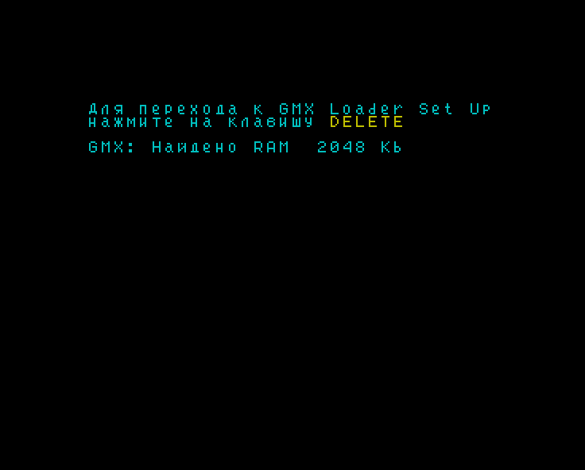
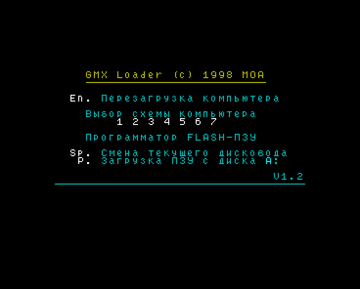
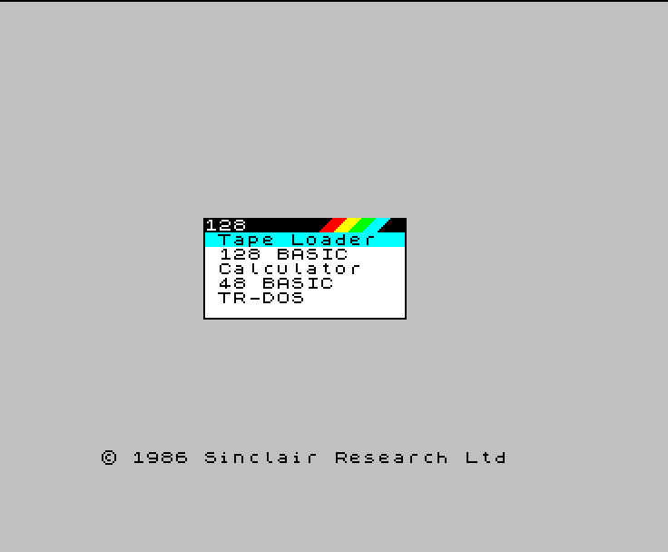
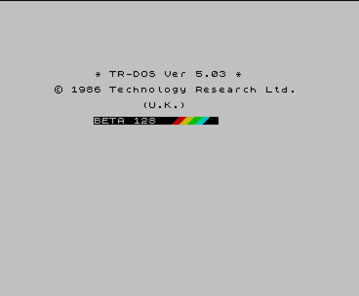
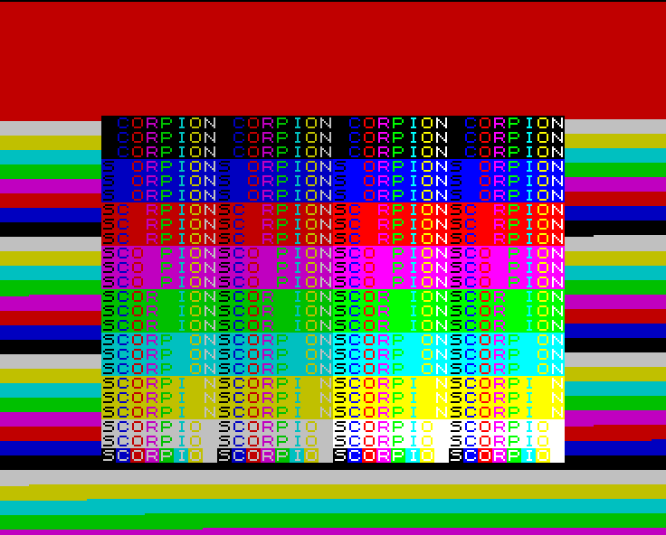
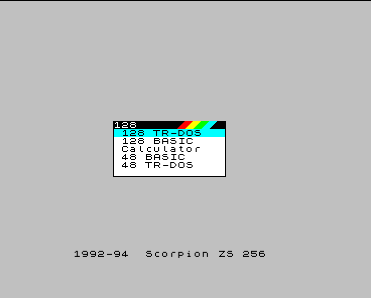

# Scorpion GMX: схемы FPGA и CPLD, сборка прошивки

GMX (Graphic Memory eXpander) - плата расширения Scorpion ZS-256: ПЛИС Altera FLEX EPF8452ALC84, CPLD Altera MAX EPM7064SLC44, процессор Z80, Flash 28F400.

Каталог содержит исходные тексты схем ПЛИС и CPLD на AHDL (MAX+PLUS II 10.23), исходные части образа Flash и средства сборки образа. Схемы после компиляции функционально эквивалентны исходным прошивкам GMX: совпадают функции всех ячеек, триггеры, тактовые и асинхронные сигналы, выводы.

| каталог, файл | содержимое |
|---|---|
| [docs/](docs/) | формат битстрима FLEX 8000 и POF MAX 7000S, описание схем, особенности, не описанные в документации GMX, назначение выводов |
| [fpga/scorpion/](fpga/scorpion/) | схема "Scorpion" (схемы 1, 2, 5, 6, 7): AHDL, EDIF, исходный битстрим `scorpion_original.rbf`; `flat/` - нетлист по одной ячейке на узел |
| [fpga/pentagon/](fpga/pentagon/) | схема "PentaGON" (схема 4), состав тот же |
| [cpld/](cpld/) | схема CPLD: AHDL, EDIF, исходная и пересобранная конфигурации POF |
| [roms/](roms/) | исходные части Flash: загрузчик, сервисная библиотека, страницы ПЗУ банков 1..7; `layout.json` - состав банков и параметры схем FLEX |
| [bitstream/](bitstream/) | результат компиляции: битстримы FLEX (`.rbf`, `.ttf`), конфигурация CPLD (`.pof`) |
| [banks/](banks/) | результат сборки: 8 банков по 64 КБ |
| [tools/](tools/) | средства сборки (Node.js) |
| [vlsim/](vlsim/) | модель платы GMX для Verilator: Z80, нетлисты ПЛИС и CPLD исходных и собранных прошивок, сценарии тестбенчей |
| `build.cmd` | сборка |
| `clean.bat` | удаление промежуточных результатов сборки, результатов симулятора и файлов компилятора |
| `gmx.rom`, `gmx_cpld.pof` | образ Flash 512 КБ и конфигурация CPLD, собранные из исходных текстов этого каталога |
| `gmx_keepboot.rom` | образ Flash 512 КБ: страница 0 банка 0 (загрузочный блок Flash: загрузчик и Start Sch) совпадает с `gmx12501.rom`, остальное как в `gmx.rom` |
| `gmx_cbr.rom`, `gmx_cbr_keepboot.rom` | то же для схем FLEX с регенерацией DRAM циклами CAS-before-RAS (параметр CBR = 1, раздел "Регенерация DRAM") |

## Сборка

Требуются Node.js и MAX+PLUS II 10.x. Путь к компилятору задаётся переменной `MAXPLUS2`, по умолчанию `C:\maxplus2\maxplus2.exe`.

```
build.cmd              компиляция FLEX и CPLD -> bitstream\, затем roms\ + bitstream\ -> banks\ -> gmx.rom, gmx_cpld.pof
build.cmd nocompile    сборка из содержимого bitstream\ без компиляции
build.cmd keepboot     то же, что build.cmd, и дополнительно gmx_keepboot.rom
build.cmd nocompile keepboot  то же без компиляции
build.cmd keepboot cbr дополнительно схемы FLEX с CBR = 1 -> gmx_cbr.rom, gmx_cbr_keepboot.rom
build.cmd verify       проверка: roms\ и исходные битстримы дают образ gmx12501.rom без изменений
clean.bat              удаление промежуточных результатов сборки, vlsim\out\ и файлов компилятора
clean.bat dry          список удаляемых файлов
```

Шаги сборки:

| команда | действие |
|---|---|
| `node tools/compile.js scorpion\|pentagon\|cpld` | компиляция в `build/<схема>/`, результат в `bitstream/` |
| `node tools/make_banks.js` | банки из `roms/` и `bitstream/`; битстрим дополняется `0xFF` до 0x1FE6, к нему добавляются дата, параметры портов, имя и CRC16 блока; CRC страницы 0 (0x000E) и сервисной библиотеки пересчитываются |
| `node tools/compile.js scorpion\|pentagon --cbr` | компиляция с параметром CBR = 1 в `build/<схема>_cbr/`, результат `bitstream/<схема>_cbr.rbf` |
| `node tools/make_banks.js --variant cbr --out <каталог>` | банки из битстримов `<схема>_cbr.rbf` |
| `node tools/make_banks.js --keepboot --out <каталог>` | то же; блоки схем страницы 0 (Start Sch) собираются из `fpga/<схема>/<схема>_original.rbf`, страница 0 и её CRC совпадают с `gmx12501.rom` |
| `node tools/make_rom.js [--physical]` | образ `gmx.rom` из банков, копия `gmx_cpld.pof`; с ключом `--physical` - образ `gmx_flash_physical.bin` в порядке страниц микросхемы для внешнего программатора |
| `node tools/split_rom.js <образ>` | разбиение образа на `roms/` |
| `node tools/ttf2rbf.js <файл.ttf>` | преобразование `.ttf` MAX+PLUS II в двоичный битстрим |
| `node tools/clean.js [--dry]` | удаление `build/`, `banks/*.bin`, содержимого `bitstream/`, `gmx_flash_physical.bin`, результатов симулятора `vlsim/out/` и файлов компилятора; исходные тексты, `.acf`, `.edo`, `*_original.*`, `gmx*.rom`, `gmx_cpld.pof` сохраняются |

Пересобранные битстримы отличаются от исходных порядком входов LUT и трассировкой. Поэтому `gmx.rom` после компиляции отличается от `gmx12501.rom` в блоках схем FLEX и их контрольных суммах; остальное содержимое совпадает. Формат и порядок страниц `gmx.rom` совпадают с `gmx12501.rom`; образ предназначен для программатора Flash в составе GMX.

Страница 0 банка 0 (0x0000-0x3FFF: загрузчик, CRC страницы по адресу 0x000E, блок Start Sch) находится в загрузочном блоке Flash 28F400; запись в него возможна только при установленной перемычке X8. В `gmx_keepboot.rom` эта страница взята из исходной прошивки без изменений, поэтому для записи образа загрузочный блок перепрограммировать не требуется: образ отличается от `gmx12501.rom` только блоками Work Sch, DK_test, Scheme 7, PentaGON, Komposit и их CRC.

## Регенерация DRAM

Исходные схемы FLEX регенерируют DRAM только циклами чтения видеоданных. Адрес строки при видеочтении формируется счётчиками h и v на MA0..MA8, MA9 постоянен, то есть перебирается 512 строк. Этого достаточно для модулей SIMM из микросхем 1M x 1 (9 микросхем, 512 циклов за 8 мс). Микросхемам 1M x 4 (модули из 3 микросхем) требуется 1024 цикла за 16 мс; строки с другим значением MA9 обновляются только обращениями процессора, и их содержимое теряется.

Параметр `CBR` модуля `memctl` (файлы `fpga/scorpion/memctl.tdf`, `fpga/pentagon/memctl.tdf`, по умолчанию 0) включает регенерацию циклами CAS-before-RAS:
- в видеослотах бордюра и гашения (данные этих чтений не используются) CAS0/ и CAS1 активны весь слот, RAS/ опускается при опущенном CAS, WE/ = 1; строку выбирает внутренний счётчик микросхемы;
- в режиме турбо слоты бордюра отданы процессору, поэтому на бордюре 1 слот из 16 (h4..h1 = 1111) отводится под регенерацию; процессор в этом слоте ожидает (WAIT/), как в активной области;
- число циклов CBR: не менее 6 на строку растра (64 мкс) в турбо, 48 без турбо; для 1024 строк за 16 мс (250 строк растра) требуется 4,1 на строку.

| схема | CBR = 0 | CBR = 1 |
|---|---|---|
| Scorpion | 328 / 336 ячеек | 332 / 336 ячеек; компилируется с привязкой ячеек к блокам LAB (`DEMOTE_SPECIFIC_LCELL_ASSIGNMENTS_TO_LAB_ASSIGNMENTS = ON`) |
| PentaGON | 254 / 336 ячеек | 258 / 336 ячеек |

Значение параметра задаётся при компиляции разделом `GLOBAL_PARAMETERS` файла `.acf` (`node tools/compile.js <схема> --cbr`). При CBR = 0 результат компиляции не меняется. В `gmx_cbr_keepboot.rom` блок Start Sch взят из исходной прошивки и регенерацию CBR не содержит; эта схема работает после включения питания до перезагрузки FLEX рабочей схемой и при выборе схем 0, 1, 3. Проверка в модели платы: [docs/SIMULATION.md](docs/SIMULATION.md), раздел "Регенерация DRAM".

## Моделирование

Модель платы для Verilator ([vlsim/](vlsim/)) выполняет одни и те же сценарии с исходными прошивками (`orig`: `gmx12501.rom` и исходная конфигурация CPLD) и с прошивками, собранными из этого каталога (`rebuilt`: `gmx.rom`, `gmx_cpld.pof`). На всех этапах кадры видеовыхода совпадают побайтно, последовательности событий шины и загрузки ПЛИС совпадают. Подробности: [docs/SIMULATION.md](docs/SIMULATION.md).

```
vlsim\build.cmd orig
vlsim\build.cmd rebuilt
node vlsim/run.js tb
```

Кадры сняты в одно и то же время моделирования; слева `orig`, справа `rebuilt`.

| время, мс | оригинал (`orig`) | сборка (`rebuilt`) |
|---|---|---|
| 2002: тест ОЗУ, приглашение GMX Loader |  |  |
| 3660: меню GMX Loader |  |  |
| 8504: схема PentaGON, меню 128 |  |  |
| 10511: схема PentaGON, TR-DOS после кнопки Magic |  |  |
| 8020: тест платы GMX |  |  |
| 30017: схема Scorpion, меню 128 после теста ОЗУ |  |  |

## Документы

| документ | содержание |
|---|---|
| [docs/FLEX8000_EPF8452A_bitstream.md](docs/FLEX8000_EPF8452A_bitstream.md) | формат битстрима EPF8452A |
| [docs/GMX_FPGA_scorpion.md](docs/GMX_FPGA_scorpion.md) | схема FPGA "Scorpion" |
| [docs/GMX_FPGA_pentagon.md](docs/GMX_FPGA_pentagon.md) | схема FPGA "PentaGON" |
| [docs/CPLD_EPM7064S.md](docs/CPLD_EPM7064S.md) | формат POF EPM7064S, схема CPLD |
| [docs/GMX_findings.md](docs/GMX_findings.md) | особенности GMX, не описанные в документации GMX |
| [docs/SIMULATION.md](docs/SIMULATION.md) | моделирование платы: тестбенчи исходных и собранных прошивок, результаты сравнения |
| [docs/fpga_pins.csv](docs/fpga_pins.csv), [docs/cpld_pins.csv](docs/cpld_pins.csv) | назначение выводов |

Исходные тексты AHDL записаны в кодировке UTF-8.
