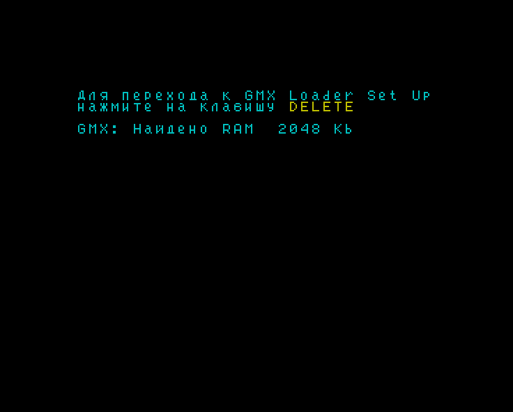
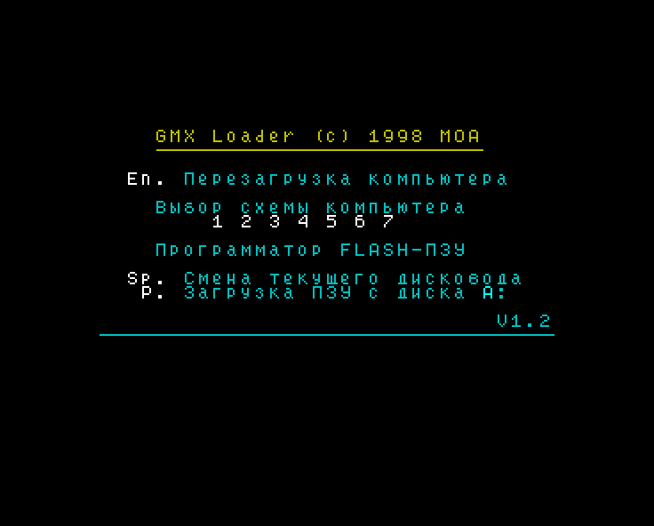
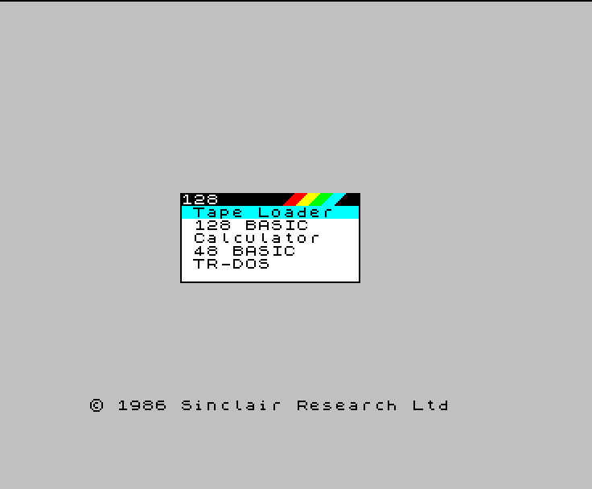
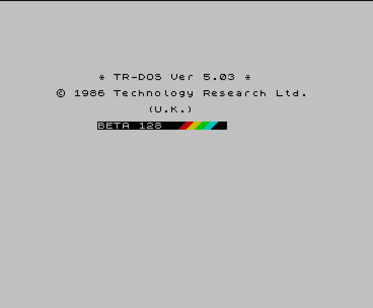
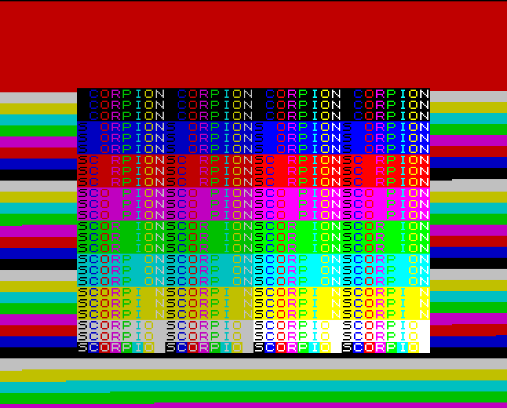
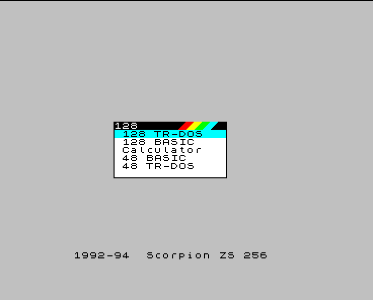

# Моделирование платы GMX

Модель платы GMX для Verilator находится в каталоге [../vlsim/](../vlsim/): процессор Z80, ПЛИС EPF8452A, CPLD EPM7064S, Flash 28F400, два модуля SIMM, логика платы. Модели ПЛИС и CPLD представлены нетлистами на Verilog, полученными из битстримов и конфигурации CPLD (одна таблица LUT и один триггер на логическую ячейку ПЛИС, сумма произведений и триггер на макроячейку CPLD). Описание модели, сборка и запуск: [../vlsim/README.md](../vlsim/README.md).

## Тестбенчи

| тестбенч | модели ПЛИС и CPLD | образ Flash |
|---|---|---|
| `orig` | из исходных прошивок: битстримы образа `gmx12501.rom`, исходная конфигурация CPLD (`vlsim/models/orig`) | `gmx12501.rom` |
| `rebuilt` | из прошивок, собранных из исходных текстов репозитория: битстримы образа `gmx.rom`, `gmx_cpld.pof` (`vlsim/models/rebuilt`) | `gmx.rom` |

Оба тестбенча выполняют одни и те же сценарии (`vlsim/testbench/*.txt`). Этапы после `boot` начинаются с состояния, сохранённого на 3700 мс.

| этап | действия |
|---|---|
| `boot` | включение питания с нажатой DELETE (CS + 0): загрузка ПЛИС, тест ОЗУ, меню GMX Loader |
| `pentagon` | клавиша 4: перезагрузка ПЛИС схемой PentaGON, меню 128, кнопка Magic, TR-DOS |
| `komposit` | клавиша 5: схема Komposit, меню 128 |
| `boardtest` | клавиша 6: тест платы GMX |
| `scorpion` | ENTER: схема Scorpion, тест ОЗУ 2 МБ, меню 128 |

## Результаты сравнения

Сравниваются кадры видеовыхода (побайтно), последовательность событий шины (запись и чтение портов, подтверждение прерывания, обращения к памяти из журнала `io.log`) и события загрузки ПЛИС.

| этап | время, мс | событий шины | кадры | события загрузки ПЛИС | наибольшее расхождение времени событий |
|---|---|---|---|---|---|
| `boot` | 0-3702 | 2894 | совпадают | совпадают | 3 мкс |
| `pentagon` | 3700-10600 | 13714 | совпадают | совпадают | 0 |
| `komposit` | 3700-8600 | 3356 | совпадают | совпадают | 0 |
| `boardtest` | 3700-8100 | 25667 | совпадают | совпадают | 0 |
| `scorpion` | 3700-30100 | 160608 | совпадают | совпадают | 0 |

Расхождение времени на этапе `boot` вызвано различием содержимого блоков схем ПЛИС в образах `gmx12501.rom` и `gmx.rom`: загрузчик вычисляет CRC16 блоков, время вычисления зависит от данных. Последовательность событий при этом совпадает.

Образ `gmx_keepboot.rom` (страница 0 из исходной прошивки, блок Start Sch с исходным битстримом, остальные блоки схем пересобраны) проверен на этапе `boot` с моделями `rebuilt` и ключом `--scorpion-alt models/orig/scorpion.rbf`: кадры, 2894 события шины и события загрузки ПЛИС совпадают с тестбенчем `orig`, расхождение времени 0.

## Кадры

Слева - тестбенч `orig`, справа - `rebuilt`; кадр снят в одно и то же время моделирования. Цвета соответствуют палитре ZX Spectrum (вывод ПЛИС G - синий, R - красный, B - зелёный).

| время, мс | оригинал (`orig`) | сборка (`rebuilt`) |
|---|---|---|
| 2002 (`boot`): тест ОЗУ, приглашение GMX Loader |  |  |
| 3660 (`boot`): меню GMX Loader |  |  |
| 8504 (`pentagon`): меню 128 |  |  |
| 10511 (`pentagon`): TR-DOS после кнопки Magic |  |  |
| 8020 (`boardtest`): тест платы GMX |  |  |
| 30017 (`scorpion`): схема Scorpion, меню 128 после теста ОЗУ |  |  |
